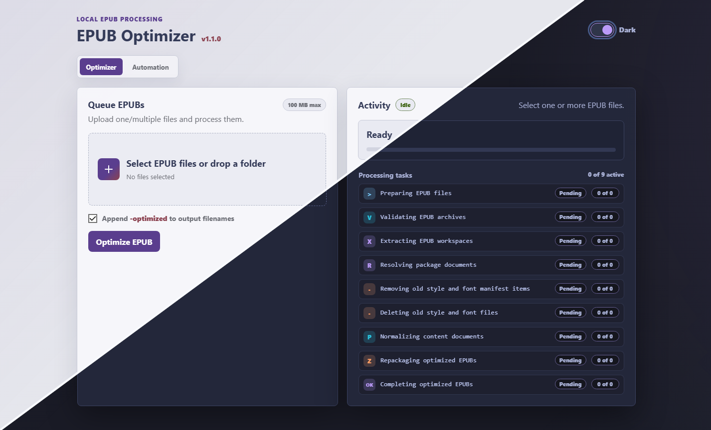

# EPUB Optimizer

A local, Dockerized web app for normalizing EPUB files into a consistent house
style.

EPUB Optimizer accepts one or more `.epub` files, processes them locally, and
returns separate `-optimized.epub` downloads. It is built for predictable,
conservative cleanup rather than aggressive rewriting.



## What It Does

- supports EPUB 2 and EPUB 3
- replaces publisher-specific CSS with one canonical stylesheet
- removes embedded font and old stylesheet package entries
- normalizes body text, headings, title pages, metadata pages, tables of
  contents, images, extracts, quotes, and front matter
- preserves readable text, spine order, metadata, navigation, links, anchors,
  inline emphasis, and image resources
- keeps image bytes unchanged
- writes a valid EPUB with the required uncompressed `mimetype` entry first

It does not remove DRM, rewrite book text, strip metadata, recompress images,
fetch remote resources, upload books anywhere, or overwrite the original EPUB.

The separate Grimmory maintenance workflow can explicitly replace library EPUBs
in place after a verified library-folder backup. It uses a strict metadata
preservation policy; the usual upload and watched-folder workflows retain their
existing behavior.

## Grimmory library maintenance

The Grimmory tab is for manually rerunning selected libraries after optimizer
improvements. It never starts a library job automatically or resumes one after
an application restart. No Docker socket or access to Grimmory's containers is
required.

The optimizer container needs explicit mounts for the selected libraries and a
separate backup directory. See
[docker-compose.grimmory.example.yml](docker-compose.grimmory.example.yml) for
an optional overlay; replace its host paths before using it. Set
`EPUB_OPTIMIZER_LIBRARY_ROOTS` to the allowed container directories (separated by
`:` on Linux) and `EPUB_OPTIMIZER_LIBRARY_BACKUP_DIR` to the backup directory.
Without allowed roots, library maintenance is disabled. These are optimizer
container paths, not paths discovered by inspecting other containers.

When the optimizer is behind a reverse proxy that terminates HTTPS, set its
public browser origin in the optimizer container environment, for example:

```yaml
environment:
  EPUB_OPTIMIZER_PUBLIC_ORIGIN: https://epubo.example.org
```

Recreate the optimizer container after changing its environment. This is the
URL you open for **EPUB Optimizer**, not the Grimmory server URL entered in the
connection form or an internal API/container address. Use a single `http://` or
`https://` origin with its port if nonstandard, without credentials, a path,
query, or fragment (a trailing `/` is accepted). Once configured, only this
origin is accepted for browser Grimmory actions, including when the proxy
connects to the optimizer over HTTP. An invalid setting blocks Grimmory actions
until corrected. Without this setting, browser actions must match the request's
own origin. Forwarding headers do not configure the allowed origin. If you see
“Same-origin requests are required,” check this setting against the optimizer
URL in your browser and have the proxy operator configure it accordingly.

1. Pause Grimmory library watchers and any other processes that can write to the
   selected folders. Keep them paused through backup, optimization, or restore.
2. Connect using the Grimmory server URL and a local account with access to the
   libraries. Credentials/tokens are not saved to the browser or persisted by
   the optimizer; reconnect after a restart or expired login.
3. Map each selected Grimmory library path to its mounted path in the optimizer
   container, then preview the scope and space requirements.
4. Confirm the maintenance window and explicitly start the job. Every selected
   file, including sidecars and non-EPUB formats, is copied to an independent,
   verified library-folder backup before any book is replaced.
5. Review per-book results. EPUBs keep their exact names and relative paths;
   unsuccessful books retain their original bytes. Cancellation takes effect
   between operations. Backups are retained until you manage them explicitly.

The library mode preserves the EPUB's bibliographic metadata and identifiers,
including existing optimizer markers. Metadata repairs are disabled and the
finished archive is checked for protected metadata changes before publication.
CSS, fonts, content presentation, and navigation may still be normalized, so
file bytes and hashes change. Official EPUBCheck must be available before a
library original can be replaced; pre-existing validation issues may remain
reported as `legacy_issues`.

Restore is an explicit action on a retained library-folder backup. Snapshot
integrity and live-file conflicts are checked before restoration. External
edits, additions, or missing files require resolution rather than silently
overwriting unrelated changes.
Interrupted jobs are reported instead of resuming automatically. Restore can
reconcile verified temporary files recorded by a job; incomplete or externally
changed temporary files remain untouched and require manual inspection.

**Backup scope:** library folders only. Grimmory's database and application data
(including catalog state, shelves, and reading progress) are not backed up or
restored by this feature. Preserve those with your normal Grimmory backup
procedure. A verified folder copy is not an atomic filesystem or database
snapshot and requires the maintenance window above for consistency. The
optimizer does not modify Grimmory's catalog through its API, but a later scan
can observe the changed EPUBs.

The upstream API is unstable; the connection uses the documented login and
library-discovery endpoints. See the
[implementation contract](docs/grimmory-library-workflow.md) for the preservation
and recovery boundaries. Development tests use temporary libraries and mocked
Grimmory responses, never a live library.

## Run

```bash
docker compose pull
docker compose up -d
```

Open:

```text
http://localhost:4200
```

The default Compose file mounts:

- `/data` for app state and temporary manual downloads
- `/watch` for optional watched-folder automation input
- `/output` for optimized files produced by automation
- `/unprocessed` for successfully processed source EPUBs, cleaned after 30 days
- `/failed` for failed automation inputs and error reports

Replace the `/output` mount with your library manager bookdrop folder when using
automation. Manual downloads and ZIP archives are removed from `/data` after
they are served.

## Local Docker Build

```bash
docker compose -f docker-compose.yml -f docker-compose.build.yml up --build
```

## Published Images

GitHub Actions validates Docker builds on pull requests and pushes to `main`.
Pushing a matching version tag publishes the image:

```text
pyproject.toml version = 1.2.3
git tag v1.2.3
git push origin v1.2.3
```

## EPUBCheck assurance

When available, the optimizer runs official EPUBCheck 5.3.0 before and after
optimization. After the initial optimized-output check, it performs bounded
deterministic repairs for supported local-reference, manifest, and OPF metadata
errors, revalidates the repaired EPUB, embeds the final report, and validates
the exact archive that will be published. The final result is marked `clean`
when no errors remain, or `legacy_issues` when only errors already present in
the input persist. Optimization fails if it introduces a new EPUBCheck error.
Repair actions and the validation outcome are recorded in the result and
META-INF report. Warnings and clearly reported legacy errors remain
non-blocking. Every run establishes a fresh input baseline, including EPUBs
that were previously optimized.

The validation outcomes mean:

- `clean`: the optimized EPUB has no EPUBCheck errors.
- `legacy_issues`: EPUBCheck errors remain, but the optimizer did not introduce
  a new diagnostic or an error at a new identifiable resource. This is a
  regression-safety result, not a claim that the EPUB passes EPUBCheck with zero
  errors.
- `unavailable`: EPUBCheck could not run. Built-in archive and structural
  validation still runs, and the unavailable status is reported explicitly.

EPUBCheck caps and summarizes repeated locations. Serialization-only changes
can alter those occurrence totals even when the relevant XHTML structure is
equivalent, so count-only changes for an already represented diagnostic and
resource are advisory. New diagnostics and new identifiable resources remain
blocking.

Set `EPUBCHECK_EXECUTABLE` to a CLI executable, or `EPUBCHECK_JAR` and `JAVA`
to use the official JAR. `EPUBCHECK_TIMEOUT` may be used by integrations to
bound subprocess execution. The Docker image bundles EPUBCheck 5.3.0 and a
Debian default headless OpenJDK runtime; see
[THIRD_PARTY_NOTICES.md](THIRD_PARTY_NOTICES.md) for provenance and licenses.

Published tags:

```text
ghcr.io/henrybaby/epub-optimizer:X.Y.Z
ghcr.io/henrybaby/epub-optimizer:latest
```

## Development

Development dependencies are installed in the repository's development image.
The development Compose project uses the `epub-optimizer-dev` project name,
the repository-owned `epub-optimizer-dev:local` image, and a `dev_data` volume.
It publishes the live-reload server on port 14200 so it does not conflict with
the production service on port 4200.

Build the development image once (and again after changing `pyproject.toml` or
the Dockerfile):

```bash
docker compose -f docker-compose.dev.yml build
```

Start the live-reload development server:

```bash
docker compose -f docker-compose.dev.yml up
```

Open <http://localhost:14200>. Source files are bind-mounted into the
container, so changes are picked up by Uvicorn without rebuilding the image.

Run lint and the test suite in the development container:

```bash
docker compose -f docker-compose.dev.yml run --rm dev ruff check .
docker compose -f docker-compose.dev.yml run --rm dev pytest
```

Stop the development service with:

```bash
docker compose -f docker-compose.dev.yml down
```
